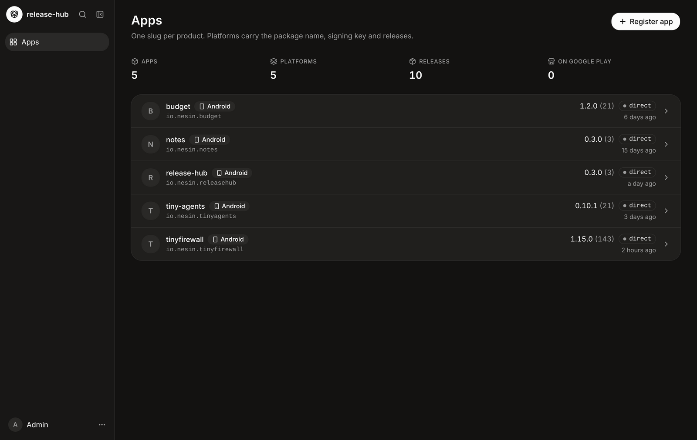
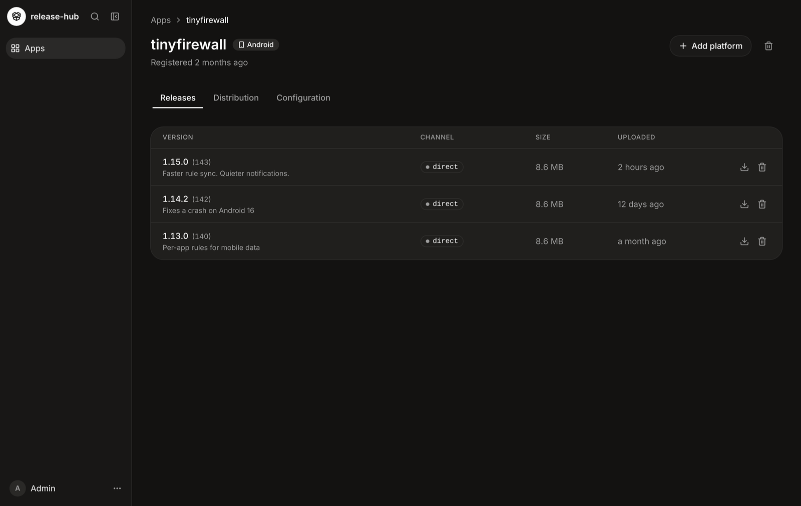
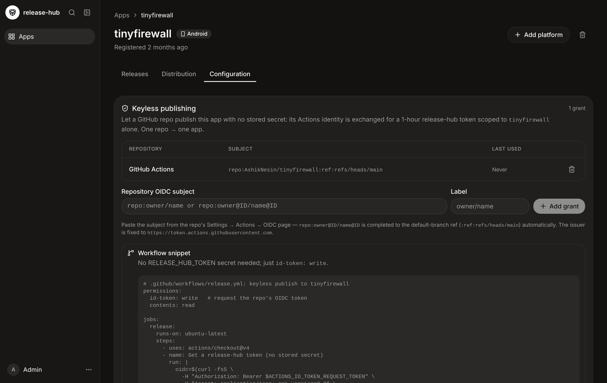
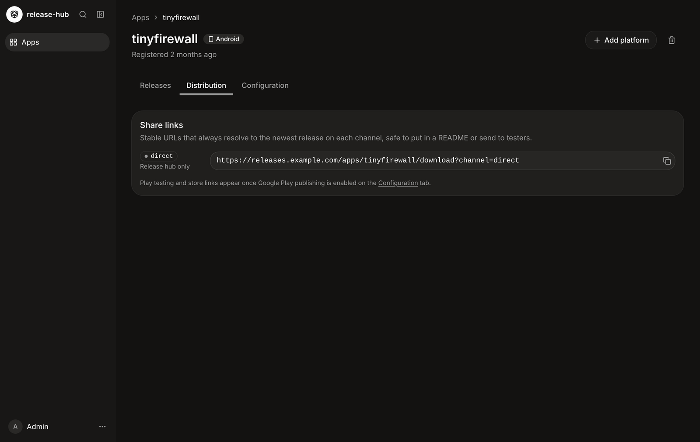
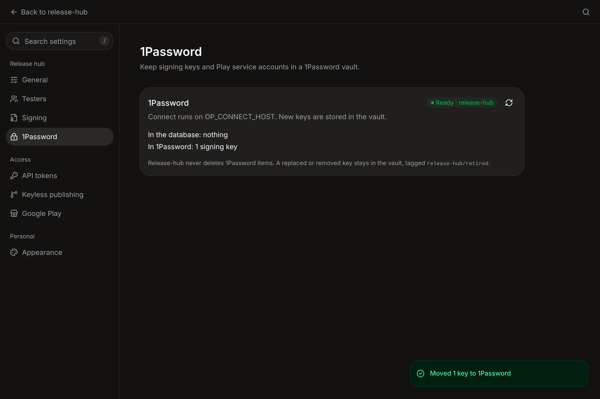
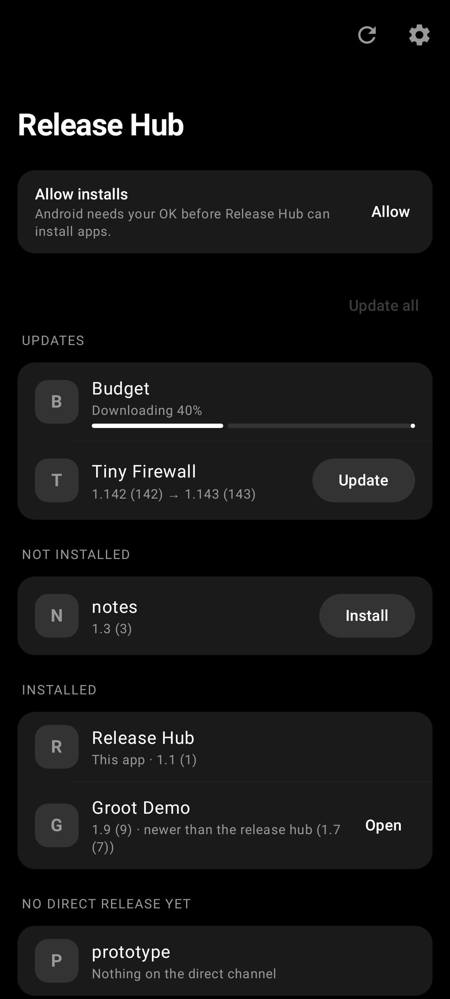
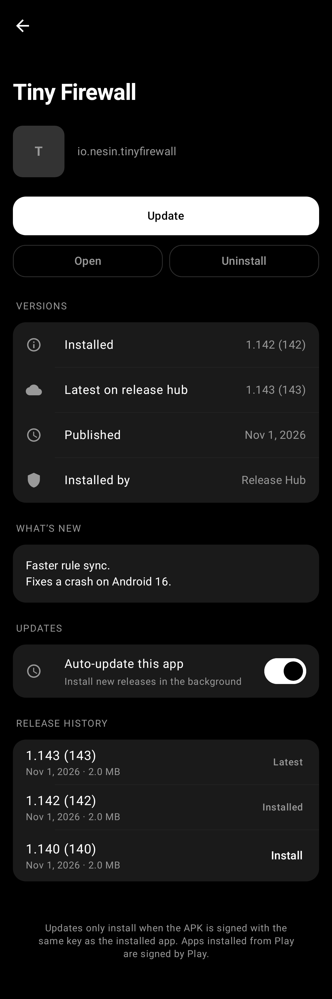
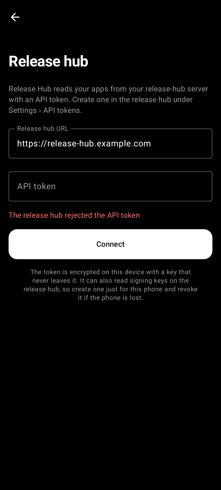

<p align="center">
  
</p>

<h1 align="center">release-hub</h1>

Your own app store backend, on your own server. release-hub holds every
build of your Android apps, signs them, hands out stable download links,
pushes to Google Play when you want it to, and keeps phones up to date
through its companion Android app. CI talks to one endpoint, with no stored
secrets.

<p align="center">
  
</p>

## Why

I ship a handful of personal Android apps, and each one used to need its own
keystore on my laptop, its own Play setup and its own way to get builds onto
my phone. release-hub puts all of that in one place: a single Go binary with
SQLite, so the keys survive a lost laptop and any build environment can
publish a signed release.

## What it does

- **Keeps every release.** Upload an APK or AAB to a channel (`direct`,
  `internal`, `alpha`, `beta`, `public`). Version codes must go up, and old
  direct builds are pruned to the number you choose.
- **Signs for you.** Adding the Android platform to an app generates its
  signing key. CI fetches it at build time, so no keystore lives in a repo.
- **Publishes without secrets.** GitHub Actions exchanges its OIDC identity
  for a one-hour token scoped to one app. Nothing to rotate, nothing to leak.
- **Pushes to Google Play.** One shared service account covers all apps.
  An `.aab` on `internal`, `alpha`, `beta` or `public` goes to the matching
  Play track, and closed testing tracks are created on first use.
- **Shares stable links.** `/apps/<slug>/download?channel=direct` always
  resolves to the newest build, and the update manifest feeds in-app
  updaters.
- **Keeps keys in 1Password, if you like.** Signing keys and Play
  credentials can live in a 1Password vault, with Connect bundled in the
  image.

<table>
  <tr>
    <td width="50%"></td>
    <td width="50%"></td>
  </tr>
  <tr>
    <td>Releases: every build, its channel, notes and size.</td>
    <td>Keyless publishing: bind a repo to an app, copy the workflow.</td>
  </tr>
  <tr>
    <td width="50%"></td>
    <td width="50%"></td>
  </tr>
  <tr>
    <td>Share links: one URL per channel, always the newest build.</td>
    <td>1Password: keys move into your vault, verified one by one.</td>
  </tr>
</table>

## Android app

**Release Hub for Android** is your own app store on your phone. Point it at
your release-hub with an API token and it lists every app, installs the
newest direct build (checked against its SHA-256), and keeps installed apps,
itself included, up to date in the background. On Android 12 and newer,
updates to apps it installed happen silently.

[**Download the APK**](https://release-hub.nesin.io/apps/release-hub/download?channel=direct)

> [!WARNING]
> The app isn't from the Play Store, so Android will warn you while
> installing it. Your browser asks to allow installs from unknown sources,
> and Play Protect may say the app is unrecognised. Allow both, and choose
> **Install anyway**, or the app won't install. Release Hub then needs the
> same permission ("Install unknown apps") to install and update your other
> apps.

<table>
  <tr>
    <td width="33%" valign="top"></td>
    <td width="33%" valign="top"></td>
    <td width="33%" valign="top"></td>
  </tr>
  <tr>
    <td>Every app, with updates queued.</td>
    <td>Release notes, history and per-app auto-update.</td>
    <td>Connect with your release-hub's URL and a token.</td>
  </tr>
</table>

The app lives in [`mobile/`](mobile/); how it works is in
[`mobile/docs/app/README.md`](mobile/docs/app/README.md).

## Try it in two minutes

You need Go 1.26, Node.js 22 and pnpm.

```sh
git clone https://github.com/AshikNesin/release-hub.git
cd release-hub
make build
RELEASE_HUB_SECRET_KEY=$(openssl rand -base64 32) ./srv/srv
```

Open http://localhost:9100, set the admin password, click **Register app**,
then add the Android platform (its signing key is generated for you).
Create a token in **Settings → API tokens** and upload a build:

```sh
curl -H "Authorization: Bearer $RELEASE_HUB_TOKEN" \
     -F file=@app-release.apk -F channel=direct -F versionName=1.0 \
     http://localhost:9100/api/apps/myapp/releases
```

`RELEASE_HUB_SECRET_KEY` encrypts signing keys and Play credentials at rest.
Keep it somewhere safe: without it, stored keys can't be opened.

## Publish from GitHub Actions

Connect GitHub once in **Settings → GitHub** (it creates this release hub's own
GitHub App), then on the app's **Configuration** tab pick the repo and press
**Connect**: that creates the grant and sets the repo's `RELEASE_HUB_URL` and
`RELEASE_HUB_APP` variables. Without the app, paste the repo's OIDC subject
(for example `repo:you/myapp`) instead. Then copy the workflow snippet. The job
asks GitHub for an identity token, swaps it for a one-hour release-hub token
and uses that to fetch the signing key and upload the build. No
`RELEASE_HUB_TOKEN` secret is stored anywhere. The full flow is in
[docs/keyless-publishing.md](docs/keyless-publishing.md), and this repo's own
[`mobile-release.yml`](.github/workflows/mobile-release.yml) uses it.

## Run it for good

- **Docker:** the image is one static binary plus the bundled 1Password
  Connect, running as an unprivileged user with everything in `/data`.
- **Coolify:** point it at this repo, mount a volume at `/data`, set
  `RELEASE_HUB_SECRET_KEY` and `RELEASE_HUB_BASE_URL`, and deploy.
- **S3:** keep artifacts in S3, R2 or MinIO instead of the volume; devices
  then download straight from the bucket.

All of it is in [docs/deploy.md](docs/deploy.md). Run it behind TLS: the
session cookie and bearer tokens must not cross the network in cleartext.

### 1Password vault

Set `OP_CONNECT_CREDENTIALS` and `OP_CONNECT_TOKEN`, and release-hub runs
1Password Connect inside its own container. New keys go to the vault, and
**Settings → 1Password** moves existing ones over. Setup and behaviour are
in [docs/1password.md](docs/1password.md).

## Docs

| Guide | What's in it |
|---|---|
| [API reference](docs/api.md) | Channels, auth, apps, platforms, releases, testers |
| [Keyless publishing](docs/keyless-publishing.md) | OIDC grants and the CI exchange |
| [Signing keys](docs/signing-keys.md) | Generated keystores, bringing your own, fetching in CI |
| [Google Play](docs/google-play.md) | Tracks, the shared service account, uploads |
| [Play walkthrough](docs/play-internal-testing.md) | Play Console setup, step by step |
| [1Password vault](docs/1password.md) | Storing keys in 1Password via Connect |
| [Deploy](docs/deploy.md) | Docker, Coolify, S3 storage |
| [Development](docs/development.md) | Building, the UI, code layout |

## Contribute

`make dev` runs the Go server and the Vite dev server with hot reload, and
`make test` runs the Go tests and the UI typecheck. The code layout and UI
conventions are in [docs/development.md](docs/development.md).
